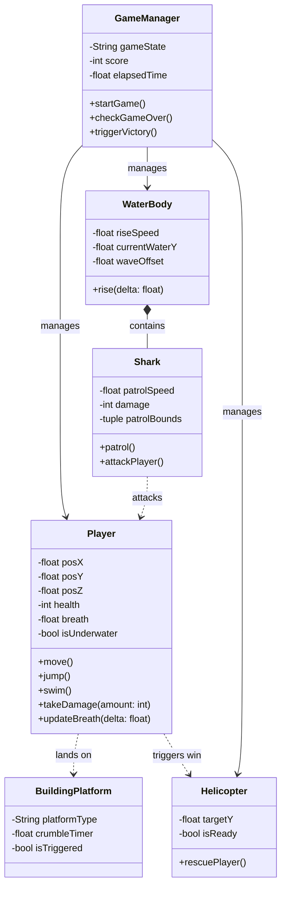
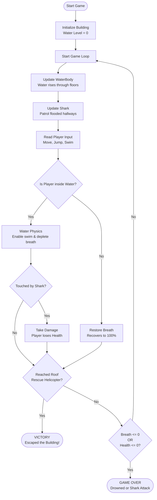

# Escape the Flooded Building

> **Academic Midterm Project — Group 3**  
> **Platform:** PC / 3D Vertical Platformer  
> **Engine:** Unity 6 (`6000.3.8f1`) — Universal Render Pipeline (URP)  
> **Input:** Unity New Input System (`com.unity.inputsystem`)

---

## 👥 Development Team & Responsibilities

| Role | Team Member | Primary Responsibility | Primary Modules & Folders |
| :--- | :--- | :--- | :--- |
| **Member 1** | **Mr. Kheng Sokthearith** | **Game Core & Integration (Lead)** | `GameManager`, Player movement & controller, Game loop, Scene integration (`Scripts/GameCore/`, `Scripts/Player/`, `Scripts/UI/`, `Scenes/`) |
| **Member 2** | **Mr. Yeat David** | **Environment & Platform** | Building interior & floors, furniture 3D models/materials, platform collisions, crumbling & floating furniture (`Scripts/Environment/`, `Prefabs/Environment/`, `Models/`, `Materials/Environment/`) |
| **Member 3** | **Mr. Thang Saoly** | **Water System** | `WaterBody`, continuously rising water, water surface & VFX, underwater detection volume, breath depletion (`Scripts/Water/`, `Prefabs/Water/`, `Materials/Water/`, `Textures/Water/`) |
| **Member 4** | **Mr. Tiek Chhunhour** | **Enemy & Rescue System** | Shark 3D model, Shark patrol AI & attack, Helicopter rescue ladder & win trigger (`Scripts/Enemy/`, `Scripts/Rescue/`, `Prefabs/Enemy/`, `Prefabs/Rescue/`) |

---

## 🌊 Game Overview

A catastrophic flash flood hits the neighborhood during an intense storm. The nearby river breaks its banks, bursting open the basement doors of a multi-story residential building. Dangerous floodwater rushes into the lower levels, bringing an aggressive shark with it.

As the homeowner trapped inside, your only salvation is vertical escape. With every passing second, the water level steadily rises from room to room. You must leap across floating furniture, unstable bookshelves, crumbling attic rafters, and chandeliers to break through to the rooftop where an emergency rescue helicopter awaits.

---

## 🎯 Objectives & Rules

### Primary Goal
Ascend through the building from the submerged basement to the rooftop, jumping across unstable furniture to climb onto the rescue helicopter's emergency ladder.

### Win Condition
* **Helicopter Contact:** The player safely reaches the rooftop and makes contact with the rescue helicopter trigger / rope ladder.

### Lose Conditions
* **Drowning (Asphyxiation):** Breath meter reaches `0` while submerged underwater.
* **Predator Attack:** Player health drops to `0` from shark bite damage (35 damage per hit).

---

## 🗺️ Zone Progression

```
+-------------------------------------------------------------+
|                      ROOFTOP & HELICOPTER                   |
|                   [WIN CONDITION TRIGGER]                   |
+-------------------------------------------------------------+
                              ▲
| ZONE 3: Attic to Rooftop                                    |
| - Fast-rising floodwaters                                   |
| - Rapidly crumbling ceiling rafters & swinging chandeliers  |
| - High-precision platforming & escape hatch traversal       |
                              ▲
| ZONE 2: Dining Room & Bedrooms                              |
| - Patrolling shark hazard entering submerged areas      |
| - Floating chairs, tilting tables, and collapsing shelves   |
| - Water submersion forces breath management                 |
                              ▲
| ZONE 1: Basement to Living Room                             |
| - Starting zone, slow water rise                            |
| - Sturdy starting platforms (wide tables, sofas)            |
| - Safe introduction to movement, jumping, and swimming      |
+-------------------------------------------------------------+
```

---

## 🎮 Controls

| Action | Keyboard & Mouse | Gamepad |
| :--- | :--- | :--- |
| **Move (Dry Land)** | `W`, `A`, `S`, `D` | Left Stick |
| **Jump** | `Space` | South Button (`A` / `Cross`) |
| **Swim (Underwater)** | `W`, `A`, `S`, `D` + Look Direction | Left Stick + Look Direction |
| **Surface / Ascend in Water** | `Space` | South Button (`A` / `Cross`) |
| **Dive / Descend in Water** | `Left Ctrl` / `C` | Right Trigger / B |
| **Camera Look** | Mouse Movement | Right Stick |
| **Pause / Menu** | `Escape` | Start / Options |

---

## 🏗️ System Architecture

### Class Hierarchy



### Game Loop Flow



---

## 📁 Repository Structure

```
Escape_The_Flood/
├── Assets/
│   ├── Scripts/               # C# Gameplay & Architecture Scripts
│   │   ├── Core/              # Player, WaterBody, Shark, BuildingPlatform, Helicopter
│   │   ├── Managers/          # GameManager, UIManager, AudioManager
│   │   └── UI/                # HealthBar, BreathMeter, TimerDisplay
│   ├── Prefabs/               # Prefabs for platforms, hazards, props
│   ├── Materials/             # Shaders, water materials, furniture textures
│   ├── Scenes/
│   │   ├── MainLevel.unity    # Primary vertical climb level
│   │   └── MainMenu.unity     # Title and game over screens
│   ├── Settings/              # URP and project graphics settings
│   └── InputSystem_Actions.inputactions
├── Packages/                  # Unity Package manifest
├── ProjectSettings/           # Unity project settings
└── README.md                  # Project overview & documentation
```

---

## 🚀 Getting Started

1. **Prerequisites:**
   * Unity **6000.3.8f1** or compatible Unity 6 release.
   * Universal Render Pipeline (URP).
   * Visual Studio 2022 / JetBrains Rider / VS Code with C# Dev Kit.

2. **Open Project:**
   * Open **Unity Hub**.
   * Click **Add** $\rightarrow$ **Add project from disk**.
   * Select the root `Escape_The_Flood` folder.
   * Ensure Editor version is set to `6000.3.8f1`.

3. **Play the Scene:**
   * In Unity Editor, navigate to `Assets/Scenes/`.
   * Open `SampleScene.unity` (or `MainLevel.unity`).
   * Press the **Play** button (`Ctrl+P` / `Cmd+P`).
